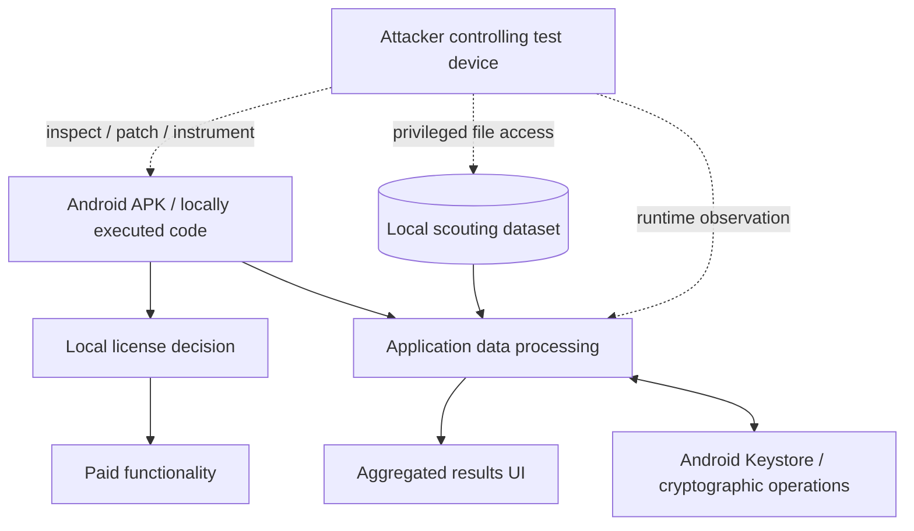

# Kouci — Android Application Threat Model

**Subtitle:** Attack Effort and Defender Cost of Client-Side Protections in an Offline-First Android Application  
**Document type:** Dissertation research artefact — threat model  
**Version:** 0.1 (working draft)  
**Date:** 7 November 2026  
**Programme:** MSc in Cybersecurity, University of Minho  
**Supervisor:** Vítor Fonte  
**Case study:** Kouci (water polo analytics application)  
**Status:** Proposed model; experimental conditions and results not yet validated

> **Central security premise:** The Android application runs on a device controlled by an attacker. Local controls may increase the effort required for specific attacks, but cannot be assumed to provide absolute resistance to inspection, modification, or runtime observation.

---

## Executive summary

This document defines the threat model for a controlled Android testbed that reproduces two security-sensitive flows from **Kouci**, an offline-first application for water polo match analytics and opponent scouting: (i) a paid-feature licensing flow and (ii) local storage and processing of a synthetic scouting dataset. The study investigates *observed attack effort* against defined objectives and *defender costs* of three separate protections: **R8**, **local APK signing-certificate verification**, and **Android Keystore-backed data encryption**.

The attacker has a copy of the application and controls its execution device; the exact privileges and instrumentation capabilities are recorded per attempt. The same researcher develops the variants and performs the attacks. Consequently, any observed differences are specific to the analyst, variants, order and conditions tested, and cannot by themselves establish the causal effect of a control on a general attacker population.

**Source alignment:** The two attack objectives, three variants, separate pilot, frozen protocol, measured outcomes and limitations are specified in the dissertation proposal. The threat identifiers, boundary names, tables, diagrams and document structure below are organisational choices introduced for this threat-model draft, not claims that the experimental design has been finally approved.

---

## 1. Purpose and scope

### 1.1 Research purpose

The threat model makes explicit:

1. what must be protected;
2. which attacker capabilities are permitted or present;
3. which paths cross relevant trust boundaries;
4. what constitutes a successful attack;
5. which protections and application variants are compared; and
6. which conditions must be captured for meaningful, reproducible measurements.

It is the **input** to the experimental protocol, not a substitute for it. The protocol will separately prescribe variant order, tool classes, adaptation rules, time budget and evidence requirements before baseline measurements.

### 1.2 In scope

- A small Android testbed reproducing Kouci's **license** and **scouting-data** workflows.
- A baseline without the three evaluated protections, storing the synthetic dataset in plaintext.
- A separate variant using R8 obfuscation, documenting shrinking/optimisation settings.
- A separate variant checking the APK signing certificate against an expected certificate in application code.
- A separate variant encrypting stored data using a non-exportable Android Keystore key.
- License bypass attempts against the baseline, R8 and certificate-check variants.
- Data-recovery attempts against the baseline and Keystore variants, via **at-rest extraction** and **runtime interception**.
- Observation of attack effort, implementation effort, APK size and performance.

### 1.3 Outside the minimum scope

Comprehensive commercial hardening of Kouci; production licensing services; continuous online checks; build-pipeline security; real customer or team data; deep desktop evaluation; white-box cryptography; and an isolated hardware-backed versus software-backed key comparison. Combining protections, a second Android device, iOS, occasional remote attestation, and runtime tamper detection are optional extensions, **not minimum requirements**.

---

## 2. System under study

### 2.1 Application context

Kouci supports water polo coaches and teams by recording match observations and presenting analytics. Some functions are paid. The application is **offline-first**, so local code must perform some licensing decisions and local data processing without relying on continuous contact with a trusted server. This constraint is fundamental: a device owner may examine the APK and observe or modify its execution.

The dissertation evaluates a **controlled testbed**, not the entire production app. It must retain the behaviour and relevant technology of the two selected flows; any simplifications compared with Kouci must be documented.

### 2.2 Logical architecture



*Conceptual diagram only. It does not claim that every Kouci implementation uses these exact components or that Keystore is present in the baseline.*

### 2.3 Workflows

**W1 — License enforcement.** The application reads or otherwise derives license state, evaluates eligibility locally and allows or denies a designated paid function. A legitimate license is absent for the targeted attack attempt.

**W2 — Protected scouting data.** The application processes a **fixed synthetic dataset** and exposes aggregated results through its intended interface. It does **not** offer the attacker an authorised way to view or export the complete dataset. The baseline stores it in plaintext; the Keystore variant stores it encrypted and decrypts it when needed for processing.

### 2.4 External dependencies

The Android operating system, its application sandbox, package/signature services and Keystore are relevant platform mechanisms. Their guarantees depend on device state, Android version, permissions and key configuration. A remote backend may be part of Kouci's wider architecture but is **not a continuously trusted authorization or data-recovery component** in these evaluated offline flows.

---

## 3. Assets and security objectives

| ID | Asset | Desired property | Why it matters |
|---|---|---|---|
| A1 | Paid-feature entitlement | Integrity of authorization | A feature should not activate without a valid license. |
| A2 | Local license-decision logic | Integrity | Modifying or redirecting checks may compromise A1. |
| A3 | Complete synthetic scouting dataset | Confidentiality | The complete plaintext dataset must not be recovered through an unauthorized route. |
| A4 | Keystore key material | Confidentiality / non-exportability | Key extraction may aid data compromise, though it is not the only attack path. |
| A5 | APK signing identity and local certificate check | Integrity / authenticity signal | The check is intended to detect repackaging and re-signing. |
| A6 | Research observations and logs | Integrity / traceability | The dissertation needs auditable evidence and correctly measured effort. |

**Primary evaluation assets:** A1 and A3. The other assets support the security controls or the credibility of the experiment. Research-log integrity (A6) is a methodological requirement rather than a separate attack objective.

---

## 4. Adversary definition

### 4.1 Attacker motivation

The attacker seeks one of the following concrete outcomes:

- **G1 — License bypass:** activate a specified paid feature without a valid license.
- **G2 — Dataset recovery:** obtain the entire fixed synthetic dataset in plaintext outside the application's normal, authorised access path.

These are separate goals. A modified APK alone is not a successful G1 attack; copying an encrypted file alone is not a successful G2 attack.

### 4.2 Baseline access and possible capabilities

The attacker may possess and run the APK on a device they control and may use common classes of static APK analysis, code modification, repackaging and runtime analysis tools. **The presence of root, debugging, an instrumentation framework, file access, user authentication or a compromised application process is not silently assumed.** Each is an explicit precondition to be recorded for a given attempt.

| Capability | Potential use | Must be recorded? |
|---|---|---|
| Obtain/install APK | Inspect executable code and resources | Yes |
| Static decompilation/disassembly | Locate license or data-processing logic | Yes |
| Modify/repackage/re-sign APK | Change checks or application behavior | Yes |
| Root/privileged file access | Read sandboxed files, subject to device conditions | Yes |
| Dynamic instrumentation | Observe or alter runtime execution | Yes |
| Process memory inspection | Observe data after decryption | Yes |
| Key-use authentication | Permit or prevent Keystore operations | Yes |
| Network access | Distinguish offline behavior from optional connectivity | Yes |

### 4.3 Researcher-as-attacker

The researcher implements the protections and then attacks them. This is a **knowledgeable, non-independent analyst**, not a blind external participant. The model does not treat source-code familiarity as absent. Before measurements, record what the analyst knows and subsequently log knowledge gained between attempts. This affects interpretation of timing, technique selection and sequence effects.

### 4.4 Assumptions

- The targeted premium functionality is not licensed in the test state.
- The synthetic dataset has a known authoritative reference copy for later equality checks.
- The application exposes only aggregate outputs during the evaluated data workflow, not the complete data through a legitimate export.
- The attacker controls the test device, but OS/kernel compromise and particular privileges are scenario-specific rather than universal assumptions.
- The chosen experimental device and software versions will be identified in the frozen protocol.

---

## 5. Trust boundaries

| ID | Boundary | What crosses it | Relevant risk |
|---|---|---|---|
| TB1 | Installed APK ↔ device owner | Application package, code and resources | Inspection, patching and repackaging |
| TB2 | License decision ↔ restricted feature | Local decision controlling privileged function | Bypassing or replacing the decision |
| TB3 | Application storage ↔ application process | Stored dataset / decrypted values | At-rest extraction and runtime disclosure |
| TB4 | Application process ↔ Android Keystore | Requests to use a non-exportable key; cryptographic outputs | Key protection does not imply plaintext protection |
| TB5 | Application ↔ Android package/signature services | Installed signing certificate information | Local verification can be altered by a powerful attacker |

**Most consequential boundary:** TB1. The defender does not control the attacker's device. Local software protections can still impose costs, but they cannot be equated with a trusted server-side enforcement point.

---

## 6. Threat catalogue

The table maps candidate threats to the two defined objectives and to the controls under evaluation. It is **not** a quantitative risk ranking or a claim that all attacks will succeed.

| ID | Threat / attack path | Primary asset | Goal | Main variant(s) |
|---|---|---|---|---|
| T01 | Static analysis identifies licensing logic | A2 | G1 | Baseline, R8 |
| T02 | Authorization checks or relevant state are patched | A1, A2 | G1 | Baseline, R8, certificate check |
| T03 | Modified APK is re-signed/repackaged | A5, A1 | G1 | Certificate check |
| T04 | Runtime execution/state is manipulated | A1, A2 | G1 | Baseline, R8, certificate check |
| T05 | Full dataset is extracted from stored files | A3 | G2 | Baseline, Keystore |
| T06 | Full plaintext dataset is intercepted in-process | A3 | G2 | Baseline, Keystore |
| T07 | Keystore key material is targeted for extraction | A4 | Supporting path to G2 | Keystore |

### 6.1 Threat chains

**License bypass, illustrative chain:** locate authorization logic → attempt to modify decision or execution state → run paid functionality with invalid license → capture proof of unauthorized activation. Local certificate verification is relevant particularly when patching requires repackaging and re-signing; dynamic circumvention must not be assumed to be blocked by that control.

**Stored-data recovery, illustrative chain:** obtain access to application-owned files → extract stored representation without executing the application → attempt to reconstruct the entire reference dataset → compare with the reference dataset. In the encrypted variant, file extraction is not equivalent to plaintext recovery.

**Runtime-data recovery, illustrative chain:** start the app under the defined state → allow it to process/decrypt the dataset → observe a point where plaintext is available in the process → reconstruct the complete dataset outside normal UI/export → verify equality. Even a non-exportable key does not prevent plaintext observation in a compromised process.

These chains describe conceptual attack surfaces; the frozen experimental protocol must specify permitted tool classes and adaptation rules rather than forcing these exact steps.

---

## 7. Attack scenarios and success criteria

### 7.1 Scenario LIC-01 — Unauthorized activation of a paid function

**Objective:** Make a specified paid feature operate when the local license state is invalid, absent or otherwise not sufficient for authorization.

**Targets:**

- **V0-L:** baseline license flow, without evaluated protections;
- **V1-R8:** R8 variant;
- **V2-SIG:** locally verified signing-certificate variant.

**Candidate methods:** static analysis, APK patching and re-signing, dynamic instrumentation, or other methods allowed by the pre-frozen protocol.

**Success:** the paid functionality demonstrably operates without a valid license, with evidence tying the observed behaviour to the specified version and license state.

**Not sufficient:** locating a check; generating a modified APK that crashes; triggering a UI change without functional access; obtaining a legitimate license.

**Evidence to preserve:** build identifier/hash, license state, attack sequence, screenshots/logs or other functional proof, timestamps and active time. The exact proof is fixed before measurement.

### 7.2 Scenario DATA-REST-01 — Full dataset recovery from storage

**Objective:** Obtain the complete fixed synthetic dataset in plaintext **without executing the application** during the extraction route.

**Targets:** **V0-D** (plaintext baseline) and **V3-KS** (Keystore-encrypted data).

**Success:** the entire recovered plaintext dataset matches the authoritative synthetic reference, recovered through an unauthorized route. Equality should use a predefined canonical form or exact record comparison, accounting for any documented serialization differences.

**Not sufficient:** finding file names; reading only ciphertext; obtaining only aggregates; retrieving a subset of records; using a legitimate export capability.

### 7.3 Scenario DATA-RUNTIME-01 — Full dataset recovery during processing

**Objective:** Recover the complete dataset by observing data while the application processes it, including **after decryption** in V3-KS.

**Targets:** **V0-D** and **V3-KS**.

**Success:** the complete synthetic reference dataset is reconstructed in plaintext outside the authorized interface/export workflow.

**Not sufficient:** observing an encryption key handle; extracting ciphertext only; viewing aggregates; reconstructing only a subset.

**Experimental separation:** DATA-REST-01 and DATA-RUNTIME-01 have different preconditions and must be recorded and interpreted independently. A successful runtime attack does not prove that the stored ciphertext or cryptographic key was directly extracted.

---

## 8. Protection variants and expected boundaries

| Variant | Modification relative to baseline | Evaluated objective | Intended defensive contribution | Limitation |
|---|---|---|---|---|
| V0 | Same flows, no evaluated protections, plaintext data | G1 and G2 | Reference condition | Offers no protection from the three evaluated mechanisms |
| V1-R8 | R8 obfuscation; document shrink/optimization flags | G1 | Potentially increases analysis/patching difficulty | No confidentiality guarantee or absolute anti-tamper capability |
| V2-SIG | Application checks APK's signing certificate against an expected value | G1 | Detects some repackaging/re-signing cases | A local check may itself be bypassed |
| V3-KS | Dataset encrypted with non-exportable Android Keystore key | G2 | Protects at-rest data/key material under defined conditions | Data may be observed when application decrypts/processes it |

Variants are **individual**, not cumulative. Except for the mechanism under test, preserve dataset, relevant behavior, device and unrelated build settings. Log every variant-specific change. Obtain and report the **security level of the key actually generated/used**; do not infer it solely from device marketing or available hardware. Document any authentication requirements or availability of the key.

---

## 9. Experimental preconditions and controls

Before an attempt, produce a condition record such as the following:

| Field | Required record |
|---|---|
| Attempt ID and goal | Unique ID; LIC-01, DATA-REST-01, or DATA-RUNTIME-01 |
| Variant | V0, V1-R8, V2-SIG, V3-KS |
| APK/build hash | Exact build identity |
| Device | Model, Android version, relevant security state |
| Root and bootloader | Actual state; no implicit assumptions |
| Debuggable state | Enabled/disabled |
| Runtime instrumentation | Tool class and availability |
| Application and dataset | Install/update state, dataset version/hash |
| License | Absent/invalid/expired and validation state |
| Keystore | Security level, alias/configuration, key use/authentication requirements |
| Connectivity | Offline/other, with rationale |
| Tool classes | Allowed by the frozen protocol |
| Analyst prior knowledge | What was known before the attempt |
| Start/stop conditions | Defined and recorded |

**Comparability principle:** do not ascribe effort differences to a control if other consequential conditions changed without documentation. The protocol should define how the analyst handles unavoidable differences and ordering effects.

---

## 10. Evaluation matrix

| Experiment | Goal | Variant | Required route(s) | Success criterion |
|---|---|---|---|---|
| E1 | G1 | V0 | License bypass | Paid feature operates without license |
| E2 | G1 | V1-R8 | License bypass | Same as E1 |
| E3 | G1 | V2-SIG | License bypass | Same as E1 |
| E4a | G2 | V0 | At-rest file extraction | Full dataset recovered as plaintext |
| E4b | G2 | V0 | Runtime interception | Full dataset recovered as plaintext |
| E5a | G2 | V3-KS | At-rest file extraction | Full dataset recovered as plaintext |
| E5b | G2 | V3-KS | Runtime interception | Full dataset recovered as plaintext |

The proposal requires attempts pertinent to each objective. The table separates the two data paths for clarity; whether they receive individual budgets and ordering is a **protocol decision to freeze**, not a settled fact in this draft.

### 10.1 Calibration pilot and protocol freeze

Conduct a pilot on a **separate** sample (e.g., training app or flow); exclude its times from the measured outcomes. Before **any** baseline or protected measurement, freeze:

- variant/attack order;
- allowed classes of tools and techniques;
- adaptation rules and permitted deviations;
- active-time budget **T** per attempt (e.g., 20 hours is illustrative, not fixed);
- start/stop criteria;
- required proof for success;
- treatment of unsuccessful attempts;
- exact datasets, hardware, build settings and repetition plan.

A dated log captures the analyst's operations and reasons for changes. Deviations from the frozen protocol must be identifiable and justified.

---

## 11. Measures and evidence

### 11.1 Attacker-side metrics

| Measure | Definition / reporting rule |
|---|---|
| Outcome | Success or **unsuccessful within T active hours** |
| Active effort | Sum of recorded hands-on time until success or termination |
| Steps | Count under a predefined step convention |
| Tool classes | Static, dynamic, patching, instrumentation, file analysis, etc. |
| Static/dynamic necessity | Whether the completed attempt required each class |
| Obstacles | Description, workaround if any, and time spent |
| Scripts/patches | Size and role of analyst-created modifications |
| Preconditions | Privileges, device/application state and authentication requirements |
| Knowledge carryover | New information learned from prior attempts |

**Censored observations:** An unsuccessful attempt halted at T hours does **not** have a measured success time of T. Report **“unsuccessful within T active hours”** separately; T represents a lower bound for the time until success in that attempt, not proof of impossibility.

### 11.2 Defender-side metrics

Record **learning time** and **integration time** separately. For each variant, measure APK size, application startup time and data access time in **cold and warm conditions** with repetitions, reporting median and dispersion. Standardise benchmark inputs, device state and build settings in the protocol. Do not assign a hypothetical performance penalty to any technique before testing.

### 11.3 Evidence package

A complete attempt record should contain:

```text
attempt-id/
  metadata.md           # variant, device, preconditions, analyst knowledge
  activity-log.csv      # timestamp, active duration, tool class, action, obstacle
  observations.md       # narrative and unsuccessful paths
  evidence/             # screenshots, logs, hashes, extracted artifacts as appropriate
  result.md             # success/unsuccessful within T, proof and limitations
```

This is a **suggested folder convention**, not a mandated original-proposal requirement. No real team/client data should be present in the evidence package.

---

## 12. Threat treatment and interpretation

This study does not use a speculative numeric risk score as its primary endpoint. Its outputs are *observations* of effort and cost. Each threat is addressed by a matched test:

- **T01–T04:** examine whether license bypass succeeds and what active effort is observed on V0, V1-R8 and V2-SIG.
- **T05:** compare full at-rest dataset recovery on V0 versus V3-KS, while holding extraction conditions explicit.
- **T06:** assess whether plaintext can be recovered during processing, including with Keystore storage encryption.
- **T07:** document Keystore key protection and observed security level. Direct key extraction is **not** required to satisfy G2 and is not a separate minimum attack objective.

**Interpretation boundary:** Observed differences do not isolate a causal effect of R8, certificate verification, or hardware-backed keys. They characterise these builds and conditions with this particular analyst.

---

## 13. Assumptions, exclusions and threats to validity

### 13.1 Construct validity

- A paid feature must actually work to count as bypassed.
- Full-dataset equality, not aggregate visibility or partial recovery, defines G2 success.
- Active attack time must be distinguished from elapsed time and from learning/integration time.
- A failed attempt is a censored observation, not a measured break time.

### 13.2 Internal validity

- Developer knowledge can shorten discovery time.
- The order of attacks creates learning and carryover effects.
- Unrelated build or environment differences may affect difficulty.
- Pilot practice may affect proficiency; hence the pilot must be separate and excluded from results.

### 13.3 External validity

- One analyst does not represent all attackers.
- A simplified Kouci testbed does not represent all offline-first Android apps.
- Results on one Android device cannot be generalized to all hardware and OS configurations.
- A reported Keystore security level is not an experimental comparison of hardware- and software-backed implementations.

### 13.4 Security limitations

- Local certificate verification is itself local logic, potentially reachable by modification or instrumentation.
- R8 is an optimisation/obfuscation tool, not an absolute confidentiality boundary.
- Keystore non-exportability protects key material within its platform guarantees, **not the plaintext after legitimate decryption inside a compromised process**.
- Offline enforcement is inherently constrained by the attacker's control over the execution environment.

---

## 14. Decisions to finalise with the supervisor

The following are **open experimental decisions**, intentionally not invented as facts:

| Decision | Why it needs to be fixed |
|---|---|
| Exact paid feature under test | Defines demonstrable G1 success |
| Exact synthetic dataset and comparison procedure | Defines verifiable G2 success |
| Test device, Android version and root state | Determines permitted attack surface |
| Instrumentation and tool categories | Limits analyst discretion |
| Key generation, access/authentication and security-level reporting | Makes Keystore conditions interpretable |
| Time budget T and per-path allocation | Determines censorship and comparability |
| Variant order and adaptation rules | Helps document learning effects |
| Cold/warm benchmark procedure and repetitions | Makes overhead measurements reproducible |
| Acceptance criteria for scripts, patches and proof | Prevents shifting definitions after seeing outcomes |

---

## 15. Proposed deliverables

1. **`threat-model.md`** — this document, versioned and reviewed.
2. **`experimental-protocol.md`** — frozen before any baseline measurement.
3. **`attack-matrix.md`** — final scenarios, conditions, budgets and order.
4. **`attack-log-template.md` / `activity-log.csv`** — timestamped step-level records.
5. **Testbed repository** — baseline and three independent variant builds, with recorded hashes and changes.
6. **Results and cost tables** — attack outcomes, censored attempts, learning/integration effort and performance distributions.

The minimum-scope dissertation remains valid even when well-documented attacks fail within the time budget. Optional extensions should be considered only after the core measurements and a complete draft are secured.

---

## 16. Source documents and references

### Source documents

- *Proteger uma app Android no dispositivo do atacante* / *Protecting an Android App on the Attacker's Device*. University of Minho, MSc Cybersecurity, dissertation proposal for 2026/2027 (supervisor: Vítor Fonte).
- *Rascunho do plano de trabalho* / *Work Plan Draft*. University of Minho, 2026/2027.
- *Leituras de partida* / *Initial Readings*. University of Minho, 2026/2027.

### Literature and technical documentation (as listed in the proposal)

1. C. S. Collberg and C. Thomborson, “Watermarking, Tamper-Proofing, and Obfuscation: Tools for Software Protection,” *IEEE Transactions on Software Engineering*, 28(8), 2002. https://doi.org/10.1109/TSE.2002.1027797
2. S. Schrittwieser, S. Katzenbeisser, J. Kinder, G. Merzdovnik, and E. Weippl, “Protecting Software through Obfuscation: Can It Keep Pace with Progress in Code Analysis?” *ACM Computing Surveys*, 49(1), Article 4, 2016. https://doi.org/10.1145/2886012
3. OWASP, *Mobile Application Security Verification Standard (MASVS)* and *Mobile Application Security Testing Guide (MASTG)*. https://mas.owasp.org/
4. Android Developers, “Android Keystore system.” https://developer.android.com/privacy-and-security/keystore
5. Android Developers, “Enable app optimization with R8.” https://developer.android.com/topic/performance/app-optimization/enable-app-optimization
6. Android Developers, `PackageManager.hasSigningCertificate`. https://developer.android.com/reference/android/content/pm/PackageManager.html

---

*Document note: This is a planning artefact, not an assertion of testing or successful protection. Replace undecided parameters with protocol-approved values and update document version before measurement begins.*
