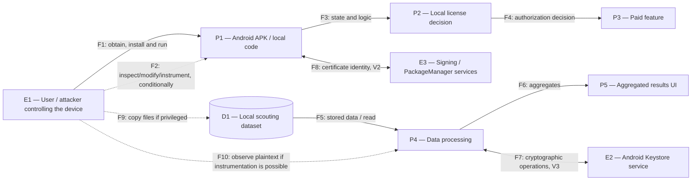

# Kouci — STRIDE Threat Model

**Version:** 1.0 — draft for supervisor review\
**Date:** 15 November 2026\
**Context:** MSc Dissertation in Cybersecurity, University of Minho\
**Supervisor:** Vítor Fonte\
**System:** Kouci — offline-first Android water polo analytics application\
**Status:** Design-stage threat model; proposed threats and controls **are not confirmed vulnerabilities**.

## 1. Executive summary

Kouci records and analyses water polo matches, including opponent scouting observations, and provides paid features. Because the application is *offline-first*, licensing decisions and useful data reside on, or are processed by, a device whose owner may be an attacker. The decisive trust boundary lies between the distributed software and the execution environment controlled by that attacker. **Neither the APK, process memory nor local verification mechanisms are assumed to be tamper-proof.**

This model uses **STRIDE-per-Element**, complemented by **STRIDE-per-Interaction** at the key trust boundaries. It identifies threats in six categories and relates them to assets, data flows, adversary capabilities, defensive controls and validation evidence. It explicitly separates two layers:

- **Dissertation experimental core:** license bypass (**G1**) and unauthorized recovery of an entire fixed synthetic scouting dataset (**G2**), independently evaluating R8, local signing-certificate verification and Android Keystore-backed encryption.
- **Kouci product security:** complementary risks concerning synchronization/backend, accounts, availability, statistics integrity, backups and distribution. These are architectural hypotheses or potential extensions, **not verified components or minimum experimental objectives**.

Threat priorities are **provisional and qualitative**, based on relevance to the study's objectives, feasibility under attacker device control and exposure of the relevant data flows. They are not DREAD scores or measurements of residual risk.

## 2. Methodology and scope

### 2.1 The four questions

1. **What are we protecting?** Licensed features, authorization logic, complete scouting data, signing identity, cryptographic material and traceable experimental evidence.
2. **What can go wrong?** Systematically apply Spoofing, Tampering, Repudiation, Information Disclosure, Denial of Service and Elevation of Privilege to elements and interactions.
3. **What will we do about it?** Mitigate, eliminate, transfer or accept threats, with a rationale for residual risk.
4. **Did we do a good enough job?** Use observable experiments, reproducible success criteria, explicit preconditions, step logs and results.

### 2.2 In scope for the dissertation

- An Android testbed reproducing Kouci's licensing and data flows with documented fidelity.
- An unprotected baseline APK with the synthetic dataset stored in plaintext.
- Three **independent** variants: `V1-R8` (R8 obfuscation), `V2-SIG` (local verification of the expected APK signing certificate), and `V3-KS` (data encrypted using a non-exportable Android Keystore key).
- `G1`: execute a specified paid feature **without a valid license**.
- `G2`: recover **the complete** synthetic dataset in plaintext outside the normal user interface or legitimate export path, either through extraction of at-rest files or observation during processing.
- Observed attacker effort and defender learning, integration, APK size and performance costs.

### 2.3 Exclusions and assumptions

The **minimum study** excludes comprehensive production hardening, attacks against a real backend, continuous online validation, the distribution/build pipeline, real user data, desktop evaluation, isolated hardware-backed versus software-backed key comparisons, remote attestation and additional anti-instrumentation mechanisms. Such areas appear only as *complementary risks*.

Root access, an unlocked bootloader, instrumentation, the ability to read other applications' private files and operating-system compromise are **not assumed**. They are scenario-specific **preconditions**, not universal attacker capabilities.

## 3. Asset inventory

| ID   | Asset                                                 | Type             | Essential property                     | Why it matters                        |
| ---- | ----------------------------------------------------- | ---------------- | -------------------------------------- | ------------------------------------- |
| A1   | Entitlement to a paid feature                         | Business process | Authorization integrity                | Revenue and business model            |
| A2   | License validation code and state                     | System/data      | Integrity                              | Controls A1                           |
| A3   | Complete synthetic scouting dataset                   | Data             | Confidentiality                        | G2 target and model of sensitive data |
| A4   | Key generated/used by Android Keystore                | System/secret    | Non-exportability; authorized key use  | At-rest confidentiality               |
| A5   | APK signing identity and local verification result    | System           | Authenticity/integrity                 | Indicator of repackaging              |
| A6   | Correct execution of paid features and aggregates     | Business process | Integrity/availability                 | Useful user-facing results            |
| A7   | Experimental evidence (hashes, logs, times, outcomes) | Data             | Integrity/traceability                 | Scientific validity                   |
| A8\* | Accounts, licenses and synchronization API            | System/data      | Authentication/authorization           | Commercial expansion, **not tested**  |
| A9\* | Real team statistics and backups                      | Data             | Confidentiality/integrity/availability | Commercial expansion, **not tested**  |

`*` Hypothetical assets in the wider architecture, included for future planning, not asserted as verified parts of the current implementation.

## 4. Adversary model

**Primary adversary — Android device owner:** possesses the APK, can install and execute the application, and can inspect distributed code/resources. Depending on the scenario, they may attempt to modify, repackage, re-sign or instrument the process. Economic motives may include using premium features without payment or obtaining data unavailable through the intended interface. Actual device control is recorded for each attempt.

**Capability profiles (not assumed to be cumulative):**

| Profile                | Defined capabilities                                                      | Notes                                                         |
| ---------------------- | ------------------------------------------------------------------------- | ------------------------------------------------------------- |
| P0 — observer          | Distributed APK, execution and static analysis                            | Does not imply access to private app files                    |
| P1 — modifier          | P0 + patching/repackaging/re-signing and installation of a self-built APK | Can change local checks; installation depends on device state |
| P2 — instrumenter      | P0 + demonstrated ability to observe/change runtime execution             | Technique and permissions recorded per attempt                |
| P3 — privileged access | P0 + authorized test access to root/private files/memory                  | Does not imply Keystore key extraction                        |


P1, P2 and P3 represent distinct capabilities. An attempt may combine them, but must disclose which apply. The researcher is also the developer and has prior code knowledge; learning may carry over between experiments.

## 5. Data flow diagram (DFD)

### 5.1 Level-0 DFD — experimental core



**Note:** `P1–P5` are logical processes, `D1` is a data store, and `E1–E3` are entities external to the application process. F7 and F8 depend on the variant. The diagram does not claim that a backend exists in the experimental testbed.

### 5.2 Trust boundaries

| ID    | Boundary                                     | Flows                    | Security question                                                       |
| ----- | -------------------------------------------- | ------------------------ | ----------------------------------------------------------------------- |
| TB1   | Distributed APK ↔ attacker-controlled device | F1, F2                   | Can local code and decision integrity be trusted?                       |
| TB2   | License validator ↔ paid feature             | F3, F4                   | Can the function's authorization decision withstand local manipulation? |
| TB3   | Local storage ↔ application process          | F5, F9, F10              | Are data protected at rest and after decryption?                        |
| TB4   | Process ↔ Android Keystore                   | F7                       | Does protecting a key also prevent plaintext exposure?                  |
| TB5   | Process ↔ PackageManager/Android signing     | F8                       | Can the local certificate check be circumvented?                        |
| TB6\* | Device ↔ synchronization API/backend         | Outside experimental DFD | Could a modified client perform unauthorized operations?                |

**TB1 is the principal trust boundary.** Inside a compromised process, a local authorization decision does not constitute an independent trust domain: TB2 is a **logical privilege boundary**, not a strong OS-enforced isolation boundary.

## 6. Systematic STRIDE analysis

### 6.1 STRIDE-per-Element matrix

Legend: `●` relevant threat; `○` examine under specific conditions; `—` no principal scenario identified within the experimental scope.

| Element                   | S — Spoofing | T — Tampering | R — Repudiation | I — Disclosure | D — DoS | E — Elevation |
| ------------------------- | ------------ | ------------- | --------------- | -------------- | ------- | ------------- |
| P1 APK/local code         | ○            | ●             | ○               | ●              | ●       | ○             |
| P2 license validator      | ●            | ●             | ○               | ○              | ●       | ●             |
| P3 paid feature           | ○            | ●             | ○               | ○              | ●       | ●             |
| D1 local dataset          | —            | ●             | ○               | ●              | ●       | —             |
| P4 processing/decryption  | ○            | ●             | ○               | ●              | ●       | ○             |
| P5 aggregates UI          | ○            | ●             | —               | ○              | ●       | ○             |
| E2 Keystore/interface     | ○            | ○             | —               | ○              | ●       | ○             |
| E3 PackageManager/signing | ●            | ○             | —               | ○              | ○       | ○             |
| F4 authorization flow     | ●            | ●             | ○               | —              | ○       | ●             |
| F5/F7/F10 data flows      | ○            | ●             | —               | ●              | ○       | ○             |

This matrix is a **screening aid**, not a claim that every marked combination is exploitable. The next catalogue identifies concrete scenarios and their relevance. Some cells concern the integrity of the research environment rather than commercially plausible attacks.

### 6.2 STRIDE threat catalogue — experimental core

| ID    | STRIDE | Element / boundary | Threat and preconditions                                                                                          | Impact / goal                                     | Priority\*            | Treatment and test                                                                       |
| ----- | ------ | ------------------ | ----------------------------------------------------------------------------------------------------------------- | ------------------------------------------------- | --------------------- | ---------------------------------------------------------------------------------------- |
| K-S01 | **S**  | P2, F4, TB2        | Forged license state or impersonated license holder in local decision; requires control of state or execution     | Unauthorized activation, **G1**                   | High                  | Do not treat local fields as strong proof; test invalid-license rejection and bypass     |
| K-S02 | **S**  | P1, E3, TB5        | Modified APK masquerades as an authentic installation; requires repackaging and installation                      | Enables **G1**                                    | High                  | `V2-SIG`: compare installed and expected certificates; attempt to bypass the local check |
| K-T01 | **T**  | P2, P3, TB1/TB2    | Change instructions, return values or authorization branches; P1 or P2                                            | **G1**                                            | **Critical**          | Measure bypass on V0, V1-R8 and V2-SIG; require functional evidence                      |
| K-T02 | **T**  | D1, P4, TB3        | Alter local data/statistics; requires file or process access                                                      | Incorrect outputs, A6                             | Medium                | Data integrity, validation and corruption tests; outside G2                              |
| K-T03 | **T**  | P1, TB1            | Repackage, re-sign and redistribute a modified APK; distribution capability not assumed                           | Code/A5 integrity; enables G1                     | High                  | Check signing identity; assess whether local check can be removed                        |
| K-R01 | **R**  | P2/P3, A7          | Misuse of paid feature without trustworthy evidence trail; offline operation and mutable local logs               | Impedes attribution/reconstruction                | Medium                | Preserve independent research evidence and hashes; do not claim user non-repudiation     |
| K-R02 | **R**  | D1, A7             | Dataset or experimental artefacts changed without traceability                                                    | Unverifiable conclusions                          | High (methodological) | Dataset/APK hashes, timestamped log and version control                                  |
| K-I01 | **I**  | D1, TB3            | Copy plaintext files with private-file access; P3 or another demonstrated capability                              | Complete recovery **G2**                          | **Critical**          | Compare V0-D and V3-KS; verify complete dataset without running app during at-rest route |
| K-I02 | **I**  | P4, F10, TB3/TB4   | Observe plaintext after decryption in an instrumented process                                                     | Complete recovery **G2**, including with Keystore | **Critical**          | DATA-RUNTIME test; separate from key/file extraction                                     |
| K-I03 | **I**  | P1/P2, TB1         | Static analysis reveals structure/algorithm of local licensing checks                                             | Reduces effort for G1 (not success by itself)     | High                  | Compare effort to locate relevant logic with and without R8                              |
| K-I04 | **I**  | A4, TB4            | Attempt to extract key material or induce cryptographic use outside intended flow; requires specific capabilities | May support G2; not equivalent to G2              | Medium                | Inspect actual key security level and restrictions; do not assume key extraction         |
| K-D01 | **D**  | P1/P3/P4           | Modified APK or malformed data causes crashes or hangs                                                            | Availability loss/A6                              | Medium                | Robustness tests; **not** a principal measured objective                                 |
| K-D02 | **D**  | D1/P4, TB3         | Dataset deletion/corruption or unavailable key blocks reading                                                     | Operational failure                               | Medium                | Integrity, error recovery and secure backup                                              |
| K-E01 | **E**  | P2→P3, TB2         | Unlicensed client obtains premium privileges                                                                      | Authorization failure **G1**                      | **Critical**          | Require real feature execution, not merely a visual UI change                            |
| K-E02 | **E**  | P1/P4, TB1/TB3     | Instrumentation or privileged access circumvents expected isolation; privilege must be demonstrated               | Supports G1/G2                                    | High (conditional)    | Record root, debug status, permissions and gained capabilities per experiment            |

`*` Priority: **Critical** = directly capable of satisfying G1/G2 under defined conditions; **High** = important enabling path or serious methodological threat; **Medium** = relevant effect outside the core outcome or dependent on specific conditions. This is neither an exploitation likelihood nor a tested result.

### 6.3 STRIDE-per-Interaction at priority boundaries

| Flow                          | Priority STRIDE questions                                                                                         | Required evidence                                                      |
| ----------------------------- | ----------------------------------------------------------------------------------------------------------------- | ---------------------------------------------------------------------- |
| F3→F4 (license→paid)          | **S:** forged state? **T:** changed decision? **E:** premium rights granted? **R:** reproducible execution trail? | Unlicensed state + actual premium operation + identified build         |
| F5/F9 (file→process/attacker) | **I:** readable at rest? **T:** can data be altered? **D:** can deletion block processing?                        | Complete dataset and exact comparison; record whether app was executed |
| F7/F10 (Keystore/processing)  | **I:** plaintext visible after decryption? **E:** privileged access required? **D:** key unavailable?             | Recovered data, observation point, key and process state               |
| F8 (app→signing identity)     | **S:** spoofed identity? **T:** altered result? **E:** validation bypass?                                         | Expected certificate, APK state and functional demonstration           |

## 7. Attack trees — illustrative paths

### 7.1 G1 — Activation without a license

```text
G1: paid feature works without a valid license
  OR
  ├─ Manipulate the license state consumed by the app [K-S01]
  ├─ Modify authorization code/branch [K-T01]
  │   └─ If required, repackage and re-sign [K-T03/K-S02]
  └─ Intercept or change runtime validation result [K-T01/K-E01]
```

**Success:** the predefined paid feature performs a real operation while the license is invalid. **Insufficient:** locating the check, changing only the UI, producing an APK that fails to launch, or obtaining a legitimate license.

### 7.2 G2 — Recovery of the complete dataset

```text
G2: entire synthetic dataset recovered in plaintext outside legitimate path
  OR
  ├─ DATA-REST: obtain file → reconstruct plaintext without running app
  │   └─ Keystore variant: copying ciphertext alone is NOT enough [K-I01]
  └─ DATA-RUNTIME: observe plaintext during processing
      └─ Includes the point after decryption where applicable [K-I02]
```

**Success:** full reconstruction of the canonical dataset, validated by record equality or an agreed canonical representation/hash. **Insufficient:** authorized export, aggregates, partial records, ciphertext, or merely observing a key alias. *At-rest* and *runtime* routes have different conditions and conclusions.

## 8. Threat → protection → limitation mapping

| Protection                       | Threats it seeks to make harder   | Validation                                                                  | Important limitation                                                                                            |
| -------------------------------- | --------------------------------- | --------------------------------------------------------------------------- | --------------------------------------------------------------------------------------------------------------- |
| **V1-R8**                        | K-I03, K-T01                      | Measure effort to locate/modify logic versus V0                             | Obfuscation does not establish an authorization trust boundary or inherently prevent instrumentation            |
| **V2-SIG**                       | K-S02, K-T03 and some K-T01 paths | Test modified/re-signed APK and possible circumvention of the local check   | The check itself executes on the attacker's device; it is distinct from Android's standard signing verification |
| **V3-KS**                        | K-I01, K-I04                      | Extract at-rest files and observe key use; report actual key security level | A non-exportable key does **not** automatically protect plaintext processed by the app [K-I02]                  |
| **Protocol and evidence hashes** | K-R01, K-R02                      | Verifiable logs, hashes, conditions and times                               | Improve rigor but do not make local logs intrinsically trustworthy                                              |

**Avoid overclaiming:** one developer-attacker, one device and the specified variants cannot establish a generally causal effect for each control. Protections must not be described as “unbreakable,” nor may an unsuccessful attempt be treated as proof of impossibility.

## 9. Experimental matrix and success criteria

| Experiment | Variant | Primary threats     | Route        | Predefined binary success condition                                  |
| ---------- | ------- | ------------------- | ------------ | -------------------------------------------------------------------- |
| E1         | V0-L    | K-S01, K-T01, K-E01 | LIC-01       | Paid function operates without valid license                         |
| E2         | V1-R8   | K-I03, K-T01, K-E01 | LIC-01       | Same as E1                                                           |
| E3         | V2-SIG  | K-S02, K-T03, K-E01 | LIC-01       | Same as E1                                                           |
| E4a        | V0-D    | K-I01               | DATA-REST    | Entire plaintext dataset recovered without running app in this route |
| E4b        | V0-D    | K-I02               | DATA-RUNTIME | Entire dataset recovered through runtime observation                 |
| E5a        | V3-KS   | K-I01, K-I04        | DATA-REST    | Same as E4a                                                          |
| E5b        | V3-KS   | K-I02               | DATA-RUNTIME | Same as E4b                                                          |

**Important:** splitting E4a/E4b/E5a/E5b is useful for planning; exact time budgets and ordering still depend on the frozen protocol.

### 9.1 Mandatory attempt record

- Attempt ID, threat, objective, variant, commit and APK SHA-256.
- Device model, Android version, root/bootloader/debug state and instrumentation availability.
- License state and reference dataset version/hash.
- Actual security level of the generated/used Keystore key and authentication requirements.
- Connectivity, permitted tool classes, prior knowledge and newly acquired knowledge.
- Chronological activity log: action, steps, **active** time, obstacle, adaptation and evidence.
- Outcome: **success** or **unsuccessful within T active hours** (censored observation).
- Defender side: learning versus integration time; APK size; cold/warm startup and data access times, with repeated measurements, median and dispersion.

### 9.2 Protocol freeze

Conduct a **separate** pilot and exclude its measurements. Before measuring **even the baseline**, freeze variant/attempt order, allowed tools, adaptation rules, active-time budget T, start/stop conditions, success proof, dataset comparison method, benchmarks and deviation policy. The proposal's **20-hour** example is illustrative, not an agreed budget.

## 10. Commercial Kouci security — complementary STRIDE analysis (outside minimum experimental scope)

The following are **hypotheses for a future architecture review**, relevant if the application uses authentication, synchronization and backend services. The existence and current design of each component must be verified.

| ID    | Category               | Potential threat                                                    | Architectural measure to verify                                                  |
| ----- | ---------------------- | ------------------------------------------------------------------- | -------------------------------------------------------------------------------- |
| X-S01 | Spoofing               | Impersonation of coach, team or device against API                  | Robust authentication, revocable session/token, organization-level authorization |
| X-T01 | Tampering              | Client changes statistics/events and synchronizes unauthorized data | Server-side validation, version control, integrity/conflict rules                |
| X-R01 | Repudiation            | Events altered/deleted without reliable attribution                 | Server-side audit trail where appropriate, with retention policy                 |
| X-I01 | Information Disclosure | API permits reading another team's data through IDOR/BOLA           | Server-side object-level and tenant authorization                                |
| X-I02 | Information Disclosure | Backup/export/logs expose match data or credentials                 | Data minimization, encryption and restricted logs/backups                        |
| X-D01 | Denial of Service      | Repeated requests exhaust synchronization resources                 | Rate limits, quotas and monitoring                                               |
| X-E01 | Elevation of Privilege | Player/coach role executes administrative operations                | RBAC and server-side privilege checks                                            |

To avoid conflating studies, **these risks must not be included in G1/G2 experimental results** without formally changing the scope.

## 11. Residual risks and treatment decisions

| Residual risk                                                       | Recommended treatment                        | Rationale                                                                              |
| ------------------------------------------------------------------- | -------------------------------------------- | -------------------------------------------------------------------------------------- |
| Bypassing local authorization on a fully attacker-controlled device | **Mitigate and accept residual limitation**  | R8/local verification may increase effort but do not move authority outside the device |
| Exposure of already-decrypted data within a compromised process     | **Mitigate and accept residual limitation**  | Keystore cannot prevent observation of legitimately used plaintext                     |
| At-rest extraction where stored files are readable                  | **Mitigate**                                 | Storage encryption directly addresses G2                                               |
| Dataset corruption/unavailability                                   | **Mitigate or explicitly accept in testbed** | Outside G1/G2 but relevant to the product                                              |
| Inaccurate effort attribution due to developer prior knowledge      | **Mitigate methodologically**                | Record knowledge, use separate pilot and freeze protocol before baseline               |
| Team account/API abuse                                              | **Assess separately**                        | Depends on wider production architecture not modeled in depth                          |

## 12. Quality criteria and open decisions

**Review checklist:** all critical assets appear in the DFD; threats are considered at relevant trust-boundary crossings; all six STRIDE classes have been examined; threats have preconditions, impact and treatment; every hypothesis has a test or an explicit exclusion rationale; positive proof is defined for experimental successes; no control is presented as invulnerable.

**Decisions to validate with the supervisor:** (1) exact paid feature; (2) synthetic dataset schema/size and canonicalization; (3) device, OS and root/debug state; (4) permitted tools/capabilities; (5) key requirements and configuration; (6) T, order and adaptation rules; (7) step/code metrics and benchmarking procedure;

## 13. Sources used

1. **STRIDE study provided by the author**, sections “Four Questions,” “DFD / Trust Boundaries,” “STRIDE,” “STRIDE-per-Element” and “STRIDE-per-Interaction.”
2. **Kouci — Android Application Threat Model**, v0.1, 7 November 2026, provided by the author. Its two goals, conditions, variants, success criteria and limitations are retained; STRIDE classification, matrices and priorities were added in this revision.
3. **Dissertation proposal:** *Protecting an Android App on the Attacker's Device*, University of Minho, 2026/27.
4. **Work Plan Draft**, University of Minho, 2026/27.
5. **Initial Readings** cited in the proposal: Collberg & Thomborson (2002); Schrittwieser et al. (2016); OWASP MASVS/MASTG; Android documentation on Keystore, R8 and PackageManager.

---

**Research integrity note:** this document identifies **plausible threat scenarios** and a validation plan. It does not report completed attacks or measured protective effectiveness. Revise it after checking the real DFD and freezing the experimental protocol.
